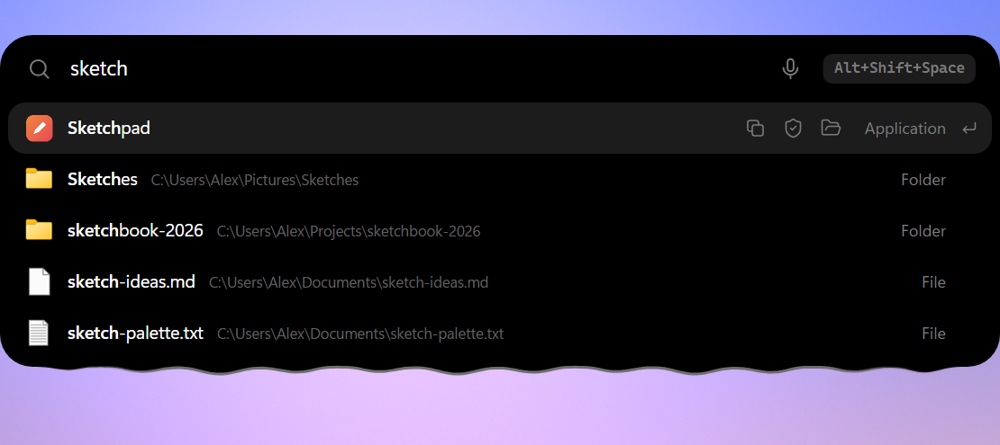
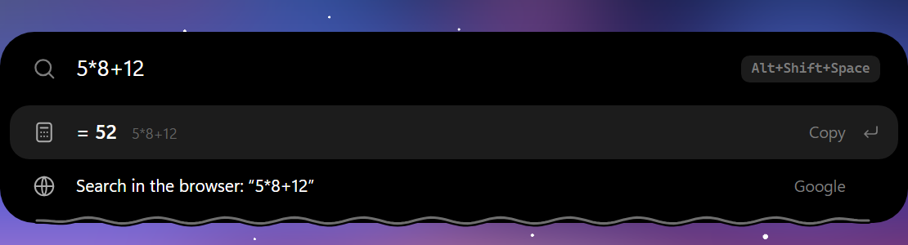
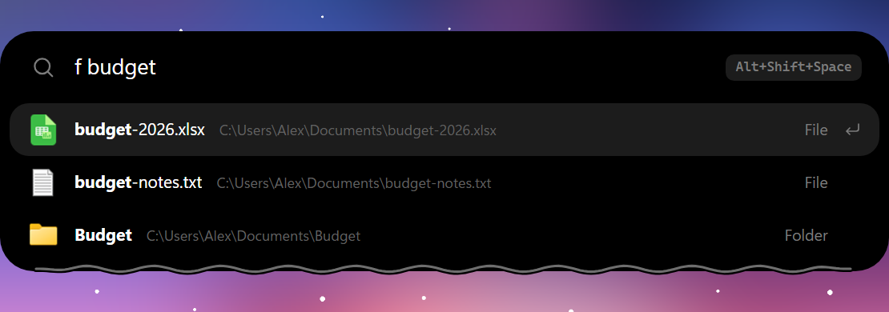

# Pill

A small "dynamic island" for the top of a Windows screen: a black capsule that shows what is playing, the clock, what your tools are doing and notifications, and grows into a panel with a clipboard history, notes, weather, an AI chat, quick controls and a command bar. Built with Tauri v2 (Rust) and plain HTML/CSS/JS.

> Pill is an independent, clean-room project. It is not affiliated with, endorsed by or derived from the code or artwork of any commercial app; it only follows the general idea of a notch-style widget.

*По-русски: небольшой «остров» в верхней части экрана Windows: музыка, часы, уведомления, статус ИИ-агентов; раскрывается в панель с историей буфера, заметками, погодой, ИИ-чатом и командной строкой.*


Project page: <https://chvdbhcx-del.github.io/pill/> (source in `docs/index.html`).

## Screenshots

The command bar (`Alt+Shift+Space`) finds applications, files and folders with their real icons, calculates, converts and runs commands. It hangs just under the island instead of covering it. A query starting with `? `, `ии ` or `ai ` asks the chat model configured in Settings > AI; the microphone button (F4) dictates into the bar.

| Apps, folders and files | Calculator | File search (`f` filter) |
| --- | --- | --- |
|  |  |  |

## Features

- Capsule with a liquid edge that reacts to music, notifications and recordings; pets/characters beside it
- Clipboard history (text, images, files) with search, pinning, paste-as-plain-text and a "wipe everything" button
- Notes, reminders and timer; weather; shelf for files; quick system controls; launcher and command bar (uses [Everything](https://www.voidtools.com/) for file search when installed)
- AI chat with local models (Ollama, LM Studio, llama.cpp, FreeLLMAPI) or a cloud provider
- Voice to text with any OpenAI-compatible Whisper endpoint, local or cloud
- Screen capture, OCR, colour picker and QR reader
- Status of coding agents (hooks for Claude Code)
- Island events with their own switches: finished downloads, USB drives, battery, the next calendar event (a local `.ics` file or an `https://` / `webcal://` subscription) and, optionally, new mail over IMAP (headers only, TLS only, password stored encrypted with Windows DPAPI)

## Privacy

Network features are **off by default**. Nothing is sent anywhere until you switch a feature on (weather, AI, voice, a calendar subscription link, new-mail notifications). Mail notifications connect only to the IMAP server you type in (TLS on port 993), read only the sender and subject of new messages, never mark anything as read and keep the password encrypted with Windows DPAPI; the calendar link is downloaded every 30 minutes and its address is never logged. The one exception is the update check: about 20 seconds after launch Pill asks GitHub whether a newer release exists (it only checks; installing is always your click). Turn it off in *Settings → Updates → Check on start*. The microphone is used only while you dictate. Clipboard history stays on your machine and skips password managers and secret-looking text by default.

## Install

Download `Pill_<version>_x64-setup.exe` from the [latest release](../../releases/latest) and run it. Updates are optional: *Settings → Updates → Check now* (or "Check on start"). Every update is signed and verified before it is installed.

## Build from source

Requirements: Windows 10/11, [Rust](https://rustup.rs/), Node.js 18+, WebView2 (included in Windows 11).

```powershell
npm install
npm run tauri dev                 # run with live front-end
npm run tauri build -- --bundles nsis
```

### Publishing a release (maintainers)

`tools/release.ps1` builds the installer, signs it with the updater key and uploads the installer, its signature and `latest.json` to a GitHub release:

```powershell
pwsh tools/release.ps1 -Notes "What is new"   # add -NoPublish to only build
```

The signing key is generated once (`npx tauri signer generate -w %USERPROFILE%\.tauri\pill-updater.key`); its public half is in `src-tauri/tauri.conf.json`. Keep the private key out of the repository and back it up: without it installed copies cannot update.

### Releasing via CI

The workflow files in `ci-templates/` are meant to be copied to `.github/workflows/` (GitHub only accepts a push there from a token with the `workflow` scope: `gh auth refresh -s workflow`). `release.yml` does the same on GitHub: bump `version` in `src-tauri/tauri.conf.json`, update `CHANGELOG.md`, then push a tag `v<version>` (or run the workflow by hand). It builds the NSIS installer and uploads it with its `.sig` and `latest.json` to the release of that tag. The repository owner must first add the secret `TAURI_SIGNING_PRIVATE_KEY` (the content of the updater key file; plus `TAURI_SIGNING_PRIVATE_KEY_PASSWORD` if it has a password); without it the workflow stops at the first step. `ci-templates/ci.yml` runs `cargo check`, `cargo test` and a syntax check of `src/*.js` on every push and pull request to `main`. The installer is not code-signed yet, so Windows SmartScreen warns on first run: see [docs/SIGNING.md](docs/SIGNING.md).

### Packaging

`packaging/winget` holds winget manifest templates; `pwsh tools/winget-manifest.ps1 -Version <v>` fills them in from a published release. Submitting them to [microsoft/winget-pkgs](https://github.com/microsoft/winget-pkgs) is a manual step, see [packaging/winget/README.md](packaging/winget/README.md).

### Development tools

`tools/dev` has scripts for checking the running app over the WebView2 debug port (evaluate JS, CPU profile, island transition audit) and a screen-based sideways-jump detector: see [tools/dev/README.md](tools/dev/README.md).

## License

[MIT](LICENSE)
