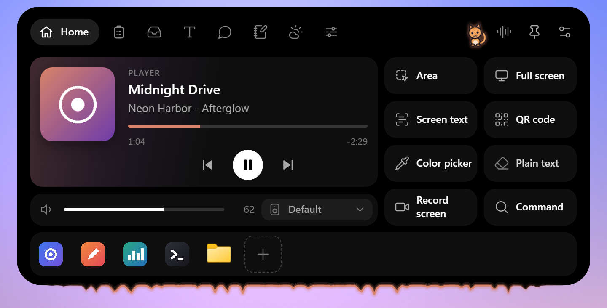
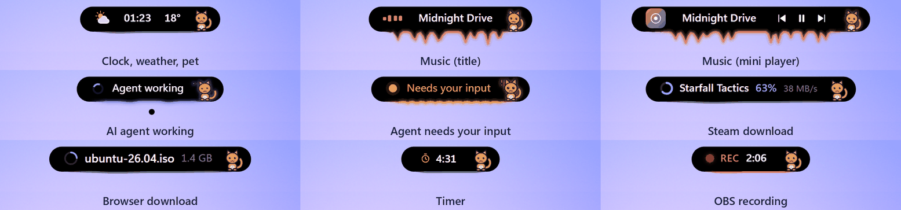
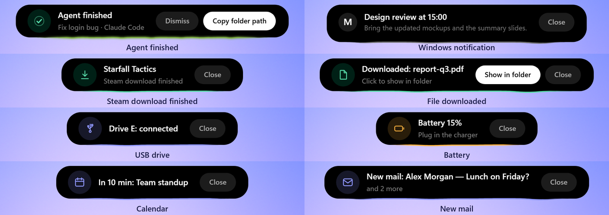
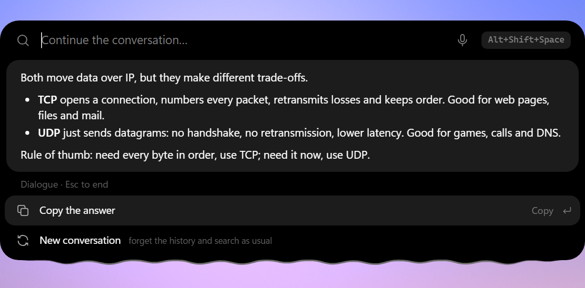
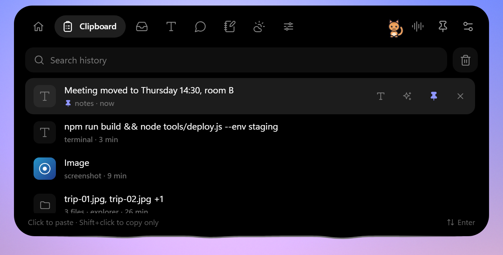
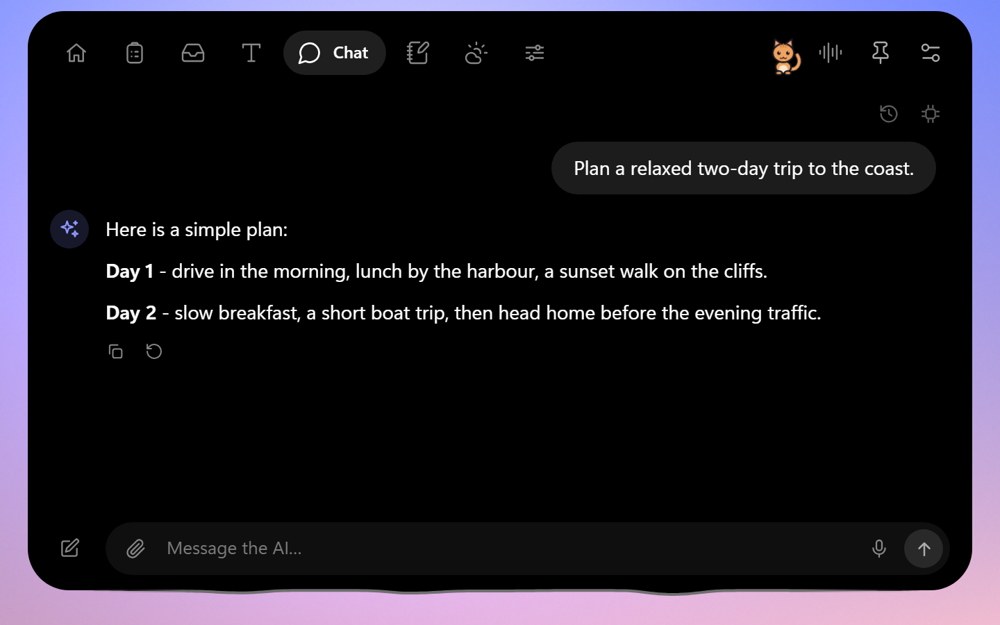
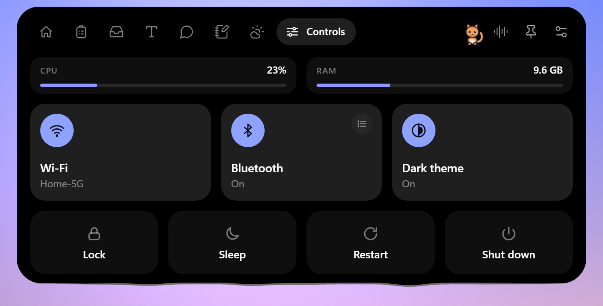
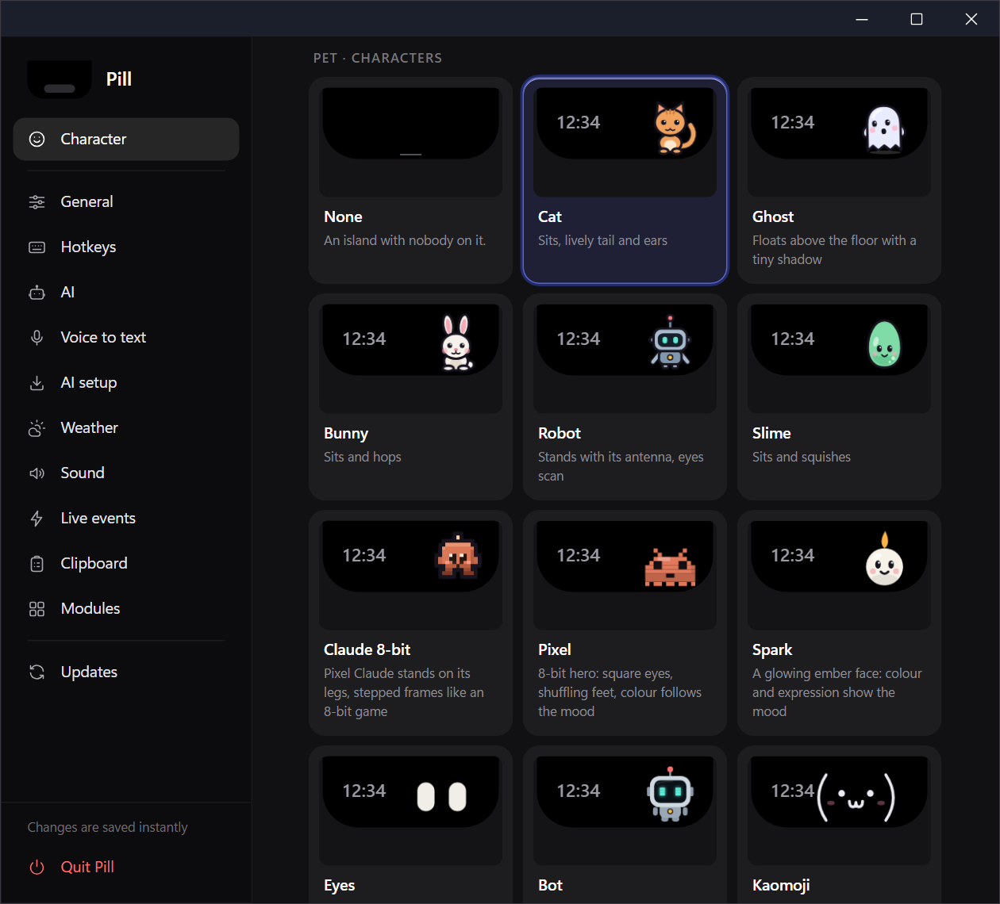

<div align="center">

# Pill

**A tiny "dynamic island" for the top of your Windows screen.**
Music, timers, downloads, AI-agent status and notifications live in a small black capsule; hover it and it grows into a panel with clipboard history, notes, weather, an AI chat and a command bar.

[](../../releases/latest)
[](LICENSE)
[](#install)
[](https://tauri.app)




[Live events](#live-events) · [Command bar](#command-bar) · [Panel](#the-panel) · [Pets](#pets-and-the-edge) · [Hotkeys](#hotkeys) · [Privacy](#privacy) · [Install](#install) · [Build](#build-from-source)

</div>

*По-русски: небольшой «остров» в верхней части экрана Windows: музыка, часы, уведомления, статус ИИ-агентов; раскрывается в панель с историей буфера, заметками, погодой, ИИ-чатом и командной строкой.*

> Pill is an independent, clean-room project. It is not affiliated with, endorsed by or derived from the code or artwork of any commercial app; it only follows the general idea of a notch-style widget.

Project page: <https://chvdbhcx-del.github.io/pill/> (source in `docs/index.html`).

## Highlights

- **A living edge.** The bottom edge of the island is liquid: it leans towards the cursor, takes the colour of what is happening and spikes to the music.
- **Live events** instead of pop-ups: music, timers, downloads, Steam, agents, USB, battery, calendar, mail, OBS, Windows notifications and more.
- **Command bar** for apps, files, folders, maths, unit conversion, system actions and questions to your own AI model.
- **Panel** with clipboard history, a file shelf, text tools, AI chat, notes with reminders and a timer, weather and quick system controls.
- **Pets and characters** that live in the capsule and react to the island.
- **Private by default.** Network features are opt-in; clipboard history stays on your machine.
- **Small and quiet.** Rust + a WebView page set written in plain HTML/CSS/JS, no framework, no telemetry.

## Live events

The folded island shows the most important thing that is going on and falls back to the clock (with weather and battery) when nothing is. Each event has its own switch in *Settings → Live events*.

<div align="center">

</div>

Chips and cards available today:

| Event | What you see |
| --- | --- |
| Music | Track title (or a mini player with cover and buttons); the edge spikes to the real spectrum of what is playing |
| Timer and reminders | A running-timer chip; a card when a reminder or timer goes off |
| AI coding agents | "Agent working" / "Needs your input" chips and an "Agent finished" card; hooks for **Claude Code** and **Codex** (the app never edits your config, *Settings* shows the snippet to paste) |
| Downloads | Progress chip for browser downloads and a card with *Show in folder* when a file lands in Downloads |
| Steam | A progress ring with game, percent and speed; a card when the download finishes |
| USB drives | A card when a drive is connected or removed |
| Battery | Warnings at 20 % and 10 %, "Charging" and "Fully charged" (laptops) |
| Calendar | "In 10 min: title" from a local `.ics` file or an `https://` / `webcal://` subscription (off by default) |
| Mail | "New mail: sender - subject" over IMAP, headers only (off by default) |
| OBS | A red REC / LIVE chip with a timer and a card with the saved recording (off by default; needs OBS's WebSocket server) |
| Windows notifications | Shown as cards instead of toasts |
| Screen recording, microphone and camera use, volume, keyboard layout, copy, GPU/CPU too hot | Small chips and reactions of the edge |

<div align="center">

</div>

## Command bar

Press **`Alt+Shift+Space`** (the default; change it in *Settings → Hotkeys*). The bar hangs just under the island instead of covering it and has a liquid bottom edge of its own.

- Type to find **applications, folders and files** with their real icons. File search uses [Everything](https://www.voidtools.com/) when it is installed.
- **Calculator and unit converter** work offline: `5*8+12`, `5 km in mi`.
- **System actions** (lock, sleep, restart, shut down; destructive ones ask twice), `> command` runs a shell command, anything else can be searched in your browser.
- **Filters:** `c` clipboard, `n` notes, `f` files, `a` apps, `s` settings.
- **Ask your AI:** start with `? `, `ai ` or `ии `. The answer is formatted (lists, **bold**, code blocks with a copy button), the next line you type continues the conversation (Esc ends it). Needs an AI endpoint in *Settings → AI*.
- **Dictate** with the microphone button or `F4`.
- A selected row has buttons and a right-click menu: open, show in folder, copy the path (`Ctrl+Shift+C`), run as administrator (`Ctrl+Shift+Enter`).

| Apps, folders and files | Calculator | File search (`f` filter) |
| --- | --- | --- |
|  |  |  |

<div align="center">

</div>

## The panel

Hover the island (or press `Ctrl+Alt+I`) and it expands into a panel. Every tab is a module that can be switched off in *Settings → Modules*.

| Tab | What it does |
| --- | --- |
| **Home** | Player for whatever is playing (cover, seek, volume, output device), quick tools (area / full-screen screenshot, screen text OCR, QR reader, colour picker, screen recording, command bar) and a launcher strip: drop programs, folders or files on it |
| **Clipboard** | History of text, images and files with search, pinning, paste as plain text, AI actions on text and a "wipe everything" button |
| **Shelf** | Drag a file towards the island and drop it to keep it on the shelf; drag it out again later |
| **Text** | Text tools (case, RU/EN layout fix, transliteration, JSON, Base64, URL, sort, dedupe, word count, QR) and, with an AI endpoint, translate / fix errors / shorten / summarise / formal or friendly tone; dictation |
| **Chat** | AI chat with threads and attachments: local models (Ollama, LM Studio, llama.cpp, FreeLLMAPI) or a cloud provider; answers stream in |
| **Notes** | Notes, reminders and a timer |
| **Weather** | Current conditions, hourly slots and a 7-day forecast (MET Norway, off until you switch it on) |
| **Controls** | Wi-Fi, Ethernet, Bluetooth (with the device list), dark theme, CPU / RAM, and lock / sleep / restart / shut down (press twice) |

| Clipboard | Chat | Controls |
| --- | --- | --- |
|  |  |  |

Also built in: a first-run **AI setup** wizard (installs a local Ollama or Whisper if you want one), **voice to text** with any OpenAI-compatible Whisper endpoint (local or cloud), screen capture and recording, auto-hide, hide-in-fullscreen, a pass-through mode, Russian and English UI, light / dark / auto theme and size from 80 % to 200 %.

## Pets and the edge

The island can wear a **notch** (the default) or a floating **capsule**, and its edge can be a **liquid** line (default), a **tail**, **legs**, a soft **glow** or plain. Choose one of **28 small pets** that live inside the capsule and follow what the island does: they wake for music, think while an agent works, cheer when it finishes and fall asleep after five idle minutes.

<div align="center">

</div>

## Hotkeys

All of these are defaults and can be changed or cleared in *Settings → Hotkeys*.

| Action | Default |
| --- | --- |
| Open / close the island | `Ctrl+Alt+I` |
| **Command bar** | `Alt+Shift+Space` |
| Clipboard history | `Ctrl+Alt+V` |
| Paste without formatting | `Ctrl+Alt+Shift+V` |
| AI chat | `Ctrl+Alt+A` |
| Voice to text | `Ctrl+Alt+D` |
| Screenshot of an area / of the screen | `Ctrl+Alt+S` / `Ctrl+Alt+Shift+S` |
| Screen recording | `Ctrl+Alt+R` |
| Text from the screen (OCR) | `Ctrl+Alt+O` |
| Colour picker / QR code from the screen | `Ctrl+Alt+C` / `Ctrl+Alt+Shift+Q` |
| Mute / unmute the microphone | `Ctrl+Alt+M` |
| Quit (fixed) | `Ctrl+Alt+Q` |

## Privacy

Network features are **off by default**. Nothing is sent anywhere until you switch a feature on (weather, AI, voice, a calendar subscription link, new-mail notifications). *Settings → AI* and *Voice to text* show the hosts those features talk to and how many calls they made. Mail notifications connect only to the IMAP server you type in (TLS on port 993), read only the sender and subject of new messages, never mark anything as read and keep the password encrypted with Windows DPAPI; the calendar link is downloaded every 30 minutes and its address is never logged.

**The one exception is the update check, which is on by default:** about 20 seconds after launch Pill asks GitHub whether a newer release exists. It only checks; installing is always your click, and every update is signed and verified. Turn it off in *Settings → Updates → Check on start*.

The AI setup wizard downloads Ollama or Whisper only when you press its buttons. The microphone is used only while you dictate. Clipboard history stays on your machine and skips password managers and secret-looking text by default. There is no telemetry.

## Install

Download `Pill_<version>_x64-setup.exe` from the [latest release](../../releases/latest) and run it (English and Russian installer pages). Updates are optional: *Settings → Updates → Check now*. Every update is signed and verified before it is installed.

The installer is not code-signed yet, so Windows SmartScreen warns on first run: see [docs/SIGNING.md](docs/SIGNING.md). Requires Windows 10 or 11 and WebView2 (included in Windows 11).

What changed in each version is in [CHANGELOG.md](CHANGELOG.md); the notes of every release are also on the [releases page](../../releases).

## Build from source

Requirements: Windows 10/11, [Rust](https://rustup.rs/), Node.js 18+, WebView2 (included in Windows 11).

```powershell
npm install
npm run tauri dev                 # run with live front-end
npm run tauri build -- --bundles nsis
```

### Publishing a release (maintainers)

`tools/release.ps1` builds the installer, signs it with the updater key and uploads the installer, its signature and `latest.json` to a GitHub release:

```powershell
pwsh tools/release.ps1 -Notes "What is new"   # add -NoPublish to only build
```

The signing key is generated once (`npx tauri signer generate -w %USERPROFILE%\.tauri\pill-updater.key`); its public half is in `src-tauri/tauri.conf.json`. Keep the private key out of the repository and back it up: without it installed copies cannot update.

### Releasing via CI

The workflow files in `ci-templates/` are meant to be copied to `.github/workflows/` (GitHub only accepts a push there from a token with the `workflow` scope: `gh auth refresh -s workflow`). `release.yml` does the same on GitHub: bump `version` in `src-tauri/tauri.conf.json`, update `CHANGELOG.md`, then push a tag `v<version>` (or run the workflow by hand). It builds the NSIS installer and uploads it with its `.sig` and `latest.json` to the release of that tag. The repository owner must first add the secret `TAURI_SIGNING_PRIVATE_KEY` (the content of the updater key file; plus `TAURI_SIGNING_PRIVATE_KEY_PASSWORD` if it has a password); without it the workflow stops at the first step. `ci-templates/ci.yml` runs `cargo check`, `cargo test` and a syntax check of `src/*.js` on every push and pull request to `main`.

### Packaging

`packaging/winget` holds winget manifest templates; `pwsh tools/winget-manifest.ps1 -Version <v>` fills them in from a published release. Submitting them to [microsoft/winget-pkgs](https://github.com/microsoft/winget-pkgs) is a manual step, see [packaging/winget/README.md](packaging/winget/README.md).

### Development tools

`tools/dev` has scripts for checking the running app over the WebView2 debug port (evaluate JS, CPU profile, island transition audit) and a screen-based sideways-jump detector: see [tools/dev/README.md](tools/dev/README.md).

## License

[MIT](LICENSE)
